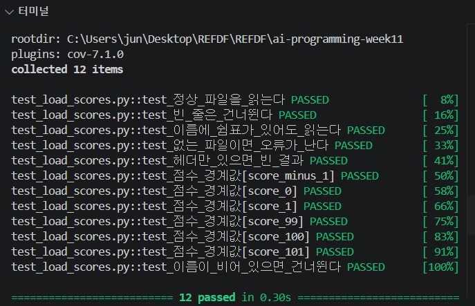

# ai-programming-week11
test
# 성적 CSV 읽기 및 테스트 실습

## 1. 무엇을 하나요? (What)

성적 CSV 파일을 읽어 유효한 이름과 점수를 반환하고, 잘못된 행은 이유와 함께 별도로 기록하는 프로그램입니다.

- 유효한 데이터는 kept에 저장합니다.
- 잘못된 데이터는 skipped에 기록합니다.
- 점수는 0부터 100까지의 정수를 허용합니다.
- 빈 줄은 기록 없이 건너뜁니다.
- 존재하지 않는 파일을 입력하면 FileNotFoundError가 발생합니다.

## 2. 왜 만들었나요? (Why)

CSV에 정상 데이터뿐 아니라 빈 이름, 잘못된 점수, 범위를 벗어난 값이 들어 있을 때 프로그램이 어떻게 처리하는지 확인하고 싶었습니다. 또한 AI가 만든 코드를 그대로 믿기보다 명세를 기준으로 정상·예외·경계값 테스트를 직접 실행하여 결과를 검증하는 방법을 익히기 위해 이 실습을 진행했습니다.

## 3. 어떻게 사용하나요? (How)

### 실행 환경

- Windows PowerShell
- Python 3
- Git

Python과 Git이 설치되어 있고 터미널에서 실행할 수 있어야 합니다.

### 저장소 내려받기

```powershell
git clone https://github.com/7777luckyj-ops/ai-programming-week11.git
cd ai-programming-week11
```

### 테스트 도구 설치

```powershell
py -m pip install pytest pytest-cov
```

### 프로그램 실행

```powershell
py load_scores.py scores.csv
```

모든 명령은 저장소 폴더 안에서 실행합니다.

Windows에서 py 대신 python 명령을 사용하는 경우에는 명령의 py를 python으로 바꿉니다.

## 4. 어떻게 테스트하나요?

### 전체 테스트 실행

```powershell
py -m pytest -v
```

### 커버리지 측정

```powershell
py -m pytest --cov=load_scores --cov-report=term-missing
```

커버리지는 테스트를 실행하면서 검사 대상 코드의 어느 부분이 실행됐는지 보여 줍니다. 테스트가 모두 통과하더라도 모든 입력과 동작을 검증했다는 의미는 아닙니다.

### 검사하는 내용

| 구분 | 검사 내용 |
|---|---|
| 정상 파일 | 정상 데이터 5개를 읽는지 확인 |
| 빈 줄 | 빈 줄을 기록 없이 건너뛰는지 확인 |
| 쉼표가 포함된 이름 | 큰따옴표 안의 쉼표를 이름의 일부로 읽는지 확인 |
| 없는 파일 | FileNotFoundError가 발생하는지 확인 |
| 헤더만 있는 파일 | kept와 skipped가 모두 빈 리스트인지 확인 |
| 점수 경계값 | -1, 0, 1, 99, 100, 101의 처리 확인 |
| 빈 이름 | 정상 데이터에서 제외하고 건너뛴 이유를 기록하는지 확인 |

### 실제 실행 결과

```text
12 passed in 0.30s
```

테스트 함수는 7개이며, 경계값 테스트에 매개변수화를 적용하여 총 12개 케이스를 실행했습니다. 위 결과는 실습에서 확인한 실행 결과이며, 실행 시간은 환경에 따라 달라질 수 있습니다.

### 테스트 실행 화면



## 5. 파일 구성

| 파일 | 역할 |
|---|---|
| load_scores.py | 성적 CSV 읽기와 데이터 검증 |
| test_load_scores.py | 정상·예외·경계값 및 빈 이름 테스트 |
| helpers.py | 수업에서 제공한 테스트 보조 함수 |
| scores.csv | 예제 성적 데이터 |
| empty.csv | 수업에서 제공한 빈 입력 시험용 CSV |
| test_result.png | 실제 테스트 실행 결과 캡처 |
| README.md | 프로그램 설명과 실행·테스트 방법 |
| .gitignore | Git 추적에서 제외할 파일 규칙 |
| LICENSE | 저장소 라이선스 |

## 6. 만든 사람 및 AI 활용

- 이름: 전준영
- 학번: 2026101014
- 소속: 한국기술교육대학교 경영학부 융합경영전공

### AI를 사용한 곳

전준영님 전용 챗봇을 활용하여 테스트 코드 작성 보조, 오류 원인 분석, 커버리지 해석, Git 명령 안내, README 초안과 표현 정리에 도움을 받았습니다. Why 문장도 실습 내용을 바탕으로 AI의 초안 작성을 도움받았습니다.

### 내가 직접 확인하고 판단한 것

테스트를 직접 실행하고 결과를 확인하면서, 검사 조건이 맞지 않아 발생하는 테스트 실패와 모듈을 찾지 못해 발생하는 수집 오류를 구분했습니다. AI가 생성한 A·B 테스트는 모듈 이름이 실제 파일과 달라 실행 전에 중단됐으므로, 테스트 수가 많다는 이유만으로 정확하거나 바로 사용할 수 있다고 판단해서는 안 된다는 점을 확인했습니다.

또한 점수 경계값과 빈 이름을 검사하는 테스트를 실행하고, 최종적으로 12개 케이스가 모두 통과하는 것을 확인했습니다. Git 작업에서는 명령어와 실행 결과를 구분하고, 프로그램과 테스트를 별도 커밋으로 기록했습니다.